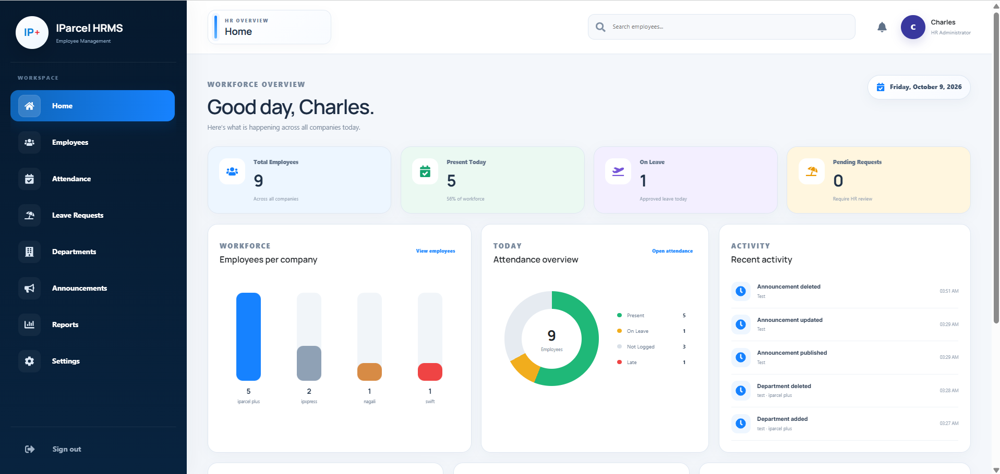
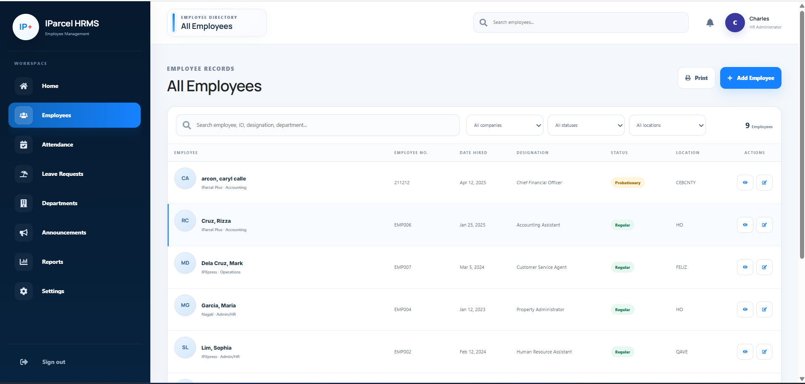
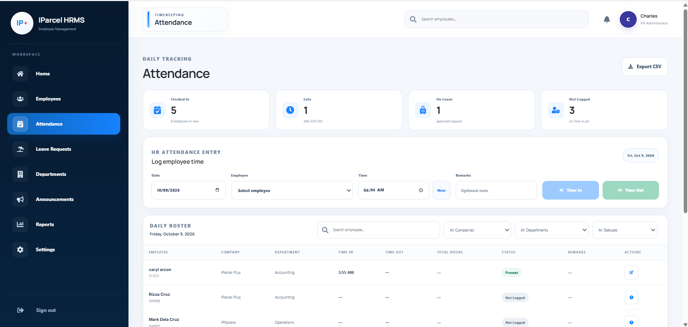
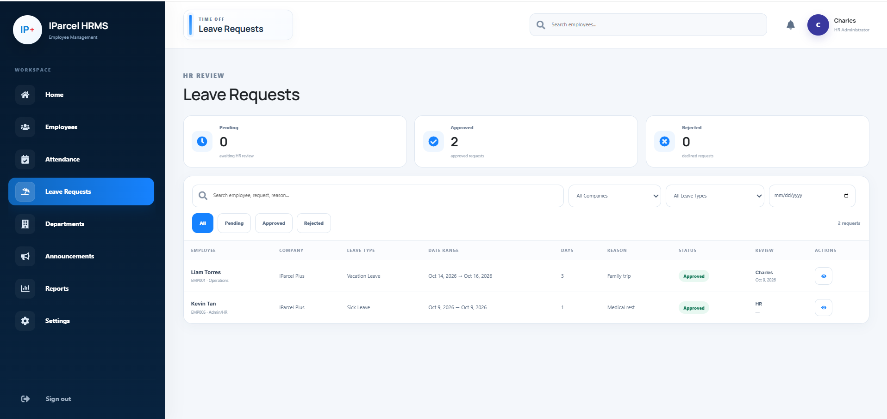
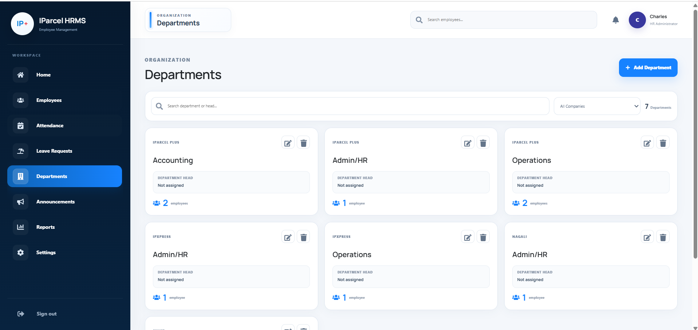
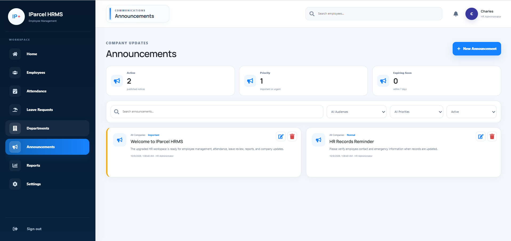
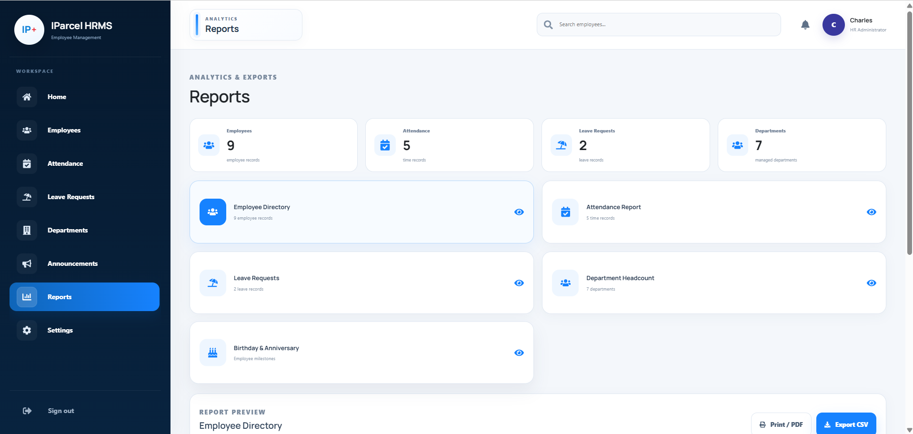
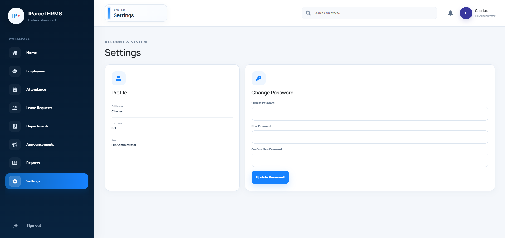
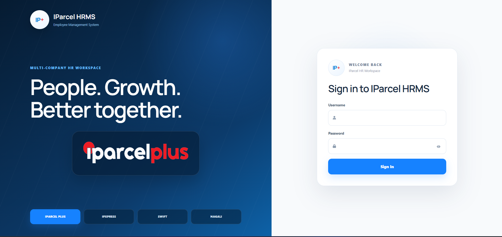

# IParcel HRMS

A full-stack, multi-company Human Resource Management System designed to centralize employee records, attendance, leave requests, departments, announcements, reports, and HR administration in one workspace.

Built as a portfolio project using **React, TypeScript, Vite, PHP, and MySQL**.

---

## Overview

IParcel HRMS gives HR administrators a centralized workspace for managing employees across four organizations:

- IParcel Plus
- IPXpress
- Swift
- Nagali

The system combines employee information management, daily attendance monitoring, leave review, organizational structure, company announcements, reporting, and account management in a consistent administrative interface.



---

## Features

### Dashboard

The HR dashboard provides an at-a-glance workforce overview with:

- Total employee count
- Employees present today
- Employees currently on leave
- Pending leave requests
- Employee distribution by company
- Attendance overview
- Recent HR activity
- Birthdays and work anniversaries


### Employee Directory

The employee module provides a searchable directory and employee record management.

Features include:

- Employee search
- Company filtering
- Employment-status filtering
- Location filtering
- Employee profile viewing
- Employee record editing
- Add Employee workflow
- Employee profile photos
- Initial-based avatar fallback
- Print-ready employee directory



The Add Employee workflow organizes information into four sections:

1. Personal Information
2. Employment Information
3. Government & Pay Information
4. Emergency Contact Information

### Attendance Management

HR administrators can record and review daily attendance.

Features include:

- Manual Time In and Time Out
- Date picker
- Time picker
- Current-time shortcut
- Attendance remarks
- Present, Late, On Leave, and Not Logged statuses
- Daily employee roster
- Search and filtering
- Company filtering
- Department filtering
- Status filtering
- Total-hours calculation
- CSV export



### Leave Requests

The Leave Requests module supports HR review of submitted leave requests.

HR administrators can:

- Review leave requests
- Approve or reject requests
- Add review notes
- View request details
- Search by employee or reason
- Filter by status
- Filter by company
- Filter by leave type
- Filter by date

Summary cards display Pending, Approved, and Rejected request counts.



### Department Management

The Departments module manages the organizational structure across the supported companies.

Features include:

- Add departments
- Edit departments
- Delete departments
- Assign department heads
- View employee counts
- Search departments
- Filter by company



### Announcements

The Announcements module provides a central area for HR and company updates.

Features include:

- Create announcements
- Edit announcements
- Delete announcements
- Company-wide or targeted audiences
- Priority levels
- Expiration dates
- Active/expired filtering
- Search and filtering
- Important-announcement highlighting



### Reports & Exports

The Reports module consolidates HR information into report-ready views.

Available reports include:

- Employee Directory
- Attendance Report
- Leave Requests
- Department Headcount
- Birthday & Anniversary Report

Reports support previewing and available print, PDF, and CSV export actions.



### Settings

The Settings module provides HR account information and password management.

Features include:

- HR profile information
- Username and administrator role
- Current-password verification
- New-password entry
- Password confirmation
- Password update



---

## Login

The application uses an administrator login screen before access to the HR workspace.



The repository uses demonstration data for local development and portfolio presentation.

---

## Technology Stack

### Frontend

- React
- TypeScript
- Vite
- Axios
- React Icons
- CSS

### Backend

- PHP
- MySQL / MariaDB
- REST-style PHP endpoints

### Development Environment

- XAMPP
- phpMyAdmin
- Node.js
- npm
- Visual Studio Code

---

## Project Structure

```text
IParcel-HRMS/
├── public/
├── src/
│   ├── assets/
│   ├── backend/
│   │   ├── hrms-backend/
│   │   │   ├── images/
│   │   │   ├── add_employee.php
│   │   │   ├── change_password.php
│   │   │   ├── config.php
│   │   │   ├── delete_announcement.php
│   │   │   ├── delete_department.php
│   │   │   ├── get_announcements.php
│   │   │   ├── get_attendance.php
│   │   │   ├── get_dashboard.php
│   │   │   ├── get_departments.php
│   │   │   ├── get_employee.php
│   │   │   ├── get_leaves.php
│   │   │   ├── login.php
│   │   │   ├── save_announcement.php
│   │   │   ├── save_attendance.php
│   │   │   ├── save_department.php
│   │   │   ├── update_employee.php
│   │   │   ├── update_leave_status.php
│   │   │   └── upload_photo.php
│   │   └── sql/
│   │       ├── hrms.sql
│   │       ├── upgrade_hrms.sql
│   │       └── upgrade_hr_modules.sql
│   ├── components/
│   ├── config/
│   ├── pages/
│   ├── styles/
│   └── types/
├── docs/
│   └── screenshots/
├── .env.example
├── .gitignore
├── eslint.config.js
├── index.html
├── package.json
├── package-lock.json
├── tsconfig.app.json
├── tsconfig.json
├── tsconfig.node.json
├── vite.config.ts
└── README.md
```

---

## Local Installation

### Requirements

Install:

- Node.js
- npm
- XAMPP
- MySQL / MariaDB
- phpMyAdmin

### 1. Install frontend dependencies

Open a terminal inside the project directory:

```bash
npm install
```

### 2. Configure the PHP backend

Copy the contents of:

```text
src/backend/hrms-backend
```

to:

```text
C:\xampp\htdocs\hrms-backend
```

Start **Apache** and **MySQL** from XAMPP.

### 3. Configure the database

Open phpMyAdmin:

```text
http://localhost/phpmyadmin
```

Import the SQL files in this order:

```text
1. src/backend/sql/hrms.sql
2. src/backend/sql/upgrade_hrms.sql
3. src/backend/sql/upgrade_hr_modules.sql
```

These scripts create the base HRMS database and the additional HR administration modules used by the application.

### 4. Configure the frontend API

The repository includes `.env.example`:

```env
VITE_API_BASE_URL=http://localhost/hrms-backend
```

If needed, create a local `.env` file from the example.

### 5. Run the application

```bash
npm run dev
```

Open the local Vite URL displayed in the terminal.

---

## Production Build

Create a production build with:

```bash
npm run build
```

The project has been verified to compile successfully with Vite.

---

## Repository & Security Notes

The repository excludes generated, local, and machine-specific files such as:

```text
node_modules/
dist/
.env
*.log
.vscode/
```

The included employee records, attendance entries, leave requests, announcements, and account data are intended for local demonstration and portfolio use.

This repository is not connected to a production HR database.

---

## Future Improvements

Potential future enhancements include:

- Role-based access control
- Employee self-service portal
- Automated biometric/time-clock integration
- Leave-balance tracking
- Payroll integration
- Email notifications
- Advanced audit-log tools
- Cloud deployment
- API authentication
- Advanced workforce analytics
- Improved mobile responsiveness

---

## Project Purpose

IParcel HRMS demonstrates practical implementation of:

- CRUD operations
- Relational database design
- React frontend development
- TypeScript
- PHP backend development
- REST-style API communication
- MySQL database integration
- Dashboard analytics
- Search and filtering
- Data export
- Multi-company employee management

---

## Developer

**Charles Jacob Lat**

Bachelor of Science in Computer Science  
University of the East - Caloocan

GitHub: [honghaei](https://github.com/honghaei)

---

## License

This project is intended for educational and portfolio demonstration purposes.
